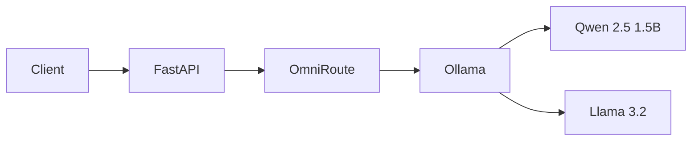

# Local LLM Orchestration & Model Swapping

Research and hands-on evaluation of local LLM serving, model selection, and request routing through a unified API.

<p align="center">
  
  
  
  
</p>

## Architecture



FastAPI provides the application API, OmniRoute handles model routing, and Ollama runs the selected local model.

## Key Features

- Unified API for multiple local LLMs.
- Request-based model selection.
- Health checks and model listing.
- Sequential switching and concurrent-request testing.
- Docker-based local inference environment.

## API Endpoints

| Method | Endpoint | Purpose |
|---|---|---|
| `GET` | `/health` | Check API health |
| `GET` | `/models` | List configured models |
| `POST` | `/generate` | Generate a model response |

Example request:

```json
{
  "model": "ollama/qwen2.5:1.5b",
  "prompt": "Explain model switching in one sentence."
}
```

Configured models:
- `ollama/qwen2.5:1.5b`
- `ollama/llama3.2:latest`

## Validation Results

| Test | Result |
|---|---|
| Sequential Qwen/Llama switching, 4 requests | PASS |
| Concurrent requests to different models, 2 requests | PASS |
| Both models available through the API | PASS |

The latest tests passed with `OLLAMA_MAX_LOADED_MODELS=1` and `OLLAMA_NUM_PARALLEL=1`. Concurrent request success does not prove both models remain loaded in memory simultaneously. Zero-downtime switching and production-scale reliability have not been established.

## Project Documentation

- [`Tool Evaluation`](docs/tool-evaluation.md) — testing evidence and comparisons.
- [`Final Recommendation`](docs/final-recommendation.md) — findings, limitations, and next steps.
